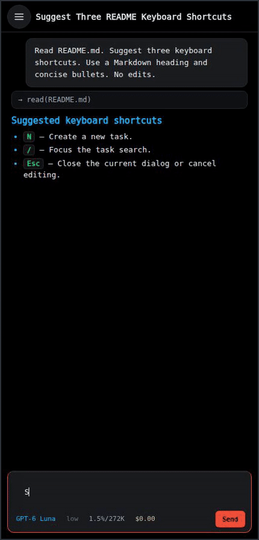
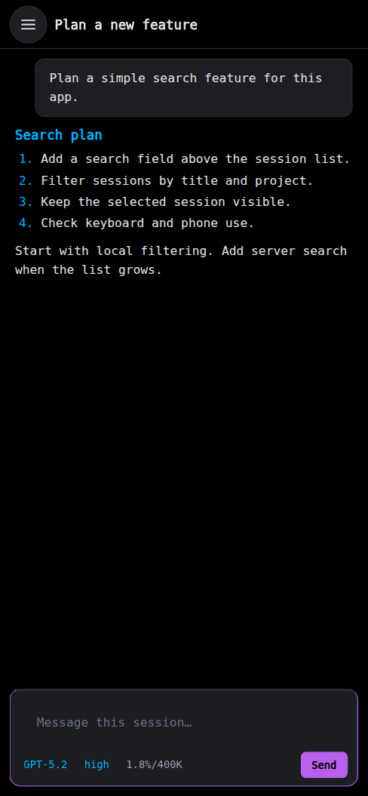
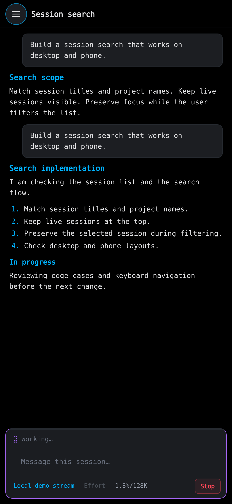
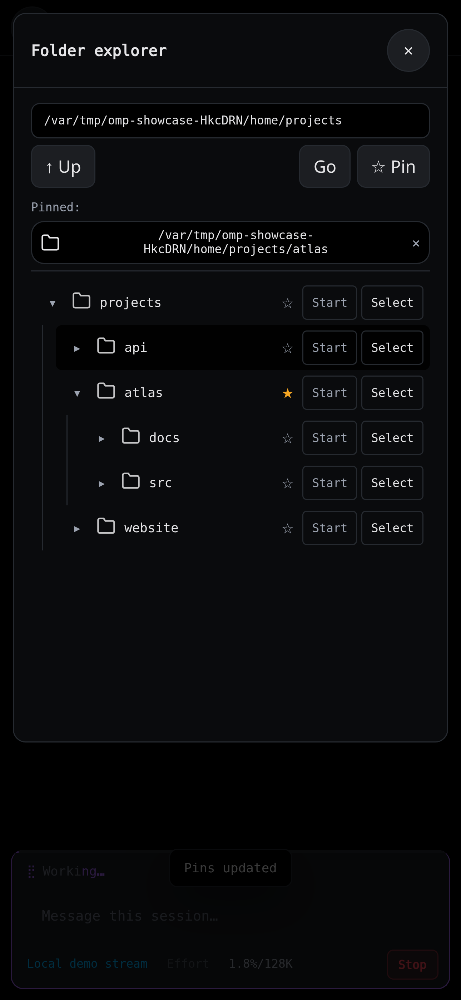

# OMP Mobile

**Your desktop sessions. On your phone.**

Send prompts, read replies, and switch sessions from your phone. OMP Mobile uses the same live [OMP](https://omp.sh) sessions as [OMP Desktop](https://github.com/cpu23/omp-desktop). Add it to your home screen.

<p align="center">
  <a href="https://github.com/cpu23/omp-mobile/releases/download/v0.1.0/launch.mp4"></a>
  <br><a href="https://github.com/cpu23/omp-mobile/releases/download/v0.1.0/launch.mp4">Watch the launch video — 17 seconds, 1080p (MP4)</a> · <a href="docs/media/demo.gif">Open demo GIF</a>
</p>

<p align="center">
  <a href="docs/images/mobile.png"></a>
  <a href="docs/images/mobile-chat.png"></a>
  <a href="docs/images/mobile-folders.png"></a>
</p>

## Requirements

- A **Linux or macOS host** with Git, [Bun 1.3+](https://bun.sh), and [OMP 18.x](https://omp.sh) on its `PATH`.
- Run `omp` on the host once. Complete the provider setup.
- A phone with a current browser. Use HTTPS for remote access and home-screen installation.
- [Tailscale](https://tailscale.com/download) on the host and phone is the simplest private connection.

## Quick setup

Run all commands on the host. Start in the folder where you keep your projects.

**1. Get both apps.** Skip a clone if you already have that repository. Keep them next to each other.

```sh
git clone https://github.com/cpu23/omp-desktop.git && git clone https://github.com/cpu23/omp-mobile.git
```

**2. Start Mobile.** Save the access token printed by this command. Do not share it.

```sh
cd omp-mobile && bun install --frozen-lockfile && bun run setup && bun run setup --show && bun run start
```

**3. Start Desktop in a second terminal.** From the same parent folder:

```sh
cd omp-desktop && bun install --frozen-lockfile && bun run start
```

Keep both terminals open. For a local check, open **<http://127.0.0.1:4173>** and paste the token.

**4. Connect your phone.** Sign in to the same Tailscale network on both devices. In a third terminal:

```sh
tailscale serve --bg 4173
```

Open the HTTPS URL that Tailscale prints. Paste the token. Use **Add to Home Screen** in your browser to install the app.

> Keep desktop port 4180 local. Share only the Mobile gateway through HTTPS. Token setup reuses an existing valid token; it does not replace it.

## Releases

**v0.1.0 — Initial source release.** [GitHub release](https://github.com/cpu23/omp-mobile/releases/tag/v0.1.0) · [Launch video (MP4)](https://github.com/cpu23/omp-mobile/releases/download/v0.1.0/launch.mp4) · [Demo GIF](https://github.com/cpu23/omp-mobile/releases/download/v0.1.0/demo.gif) · [Release notes](docs/release-v0.1.0.md).

Source only: no native mobile binaries or app-store packages. Follow [Quick setup](#quick-setup), then connect from a phone browser over HTTPS using the documented [Tailscale Serve setup](docs/guide.md#remote-access).

## Upstream & ecosystem

[OMP](https://omp.sh) · [Source](https://github.com/can1357/oh-my-pi) · [Releases](https://github.com/can1357/oh-my-pi/releases) · [Skills](https://omp.sh/docs/skills) · [Plugins](https://omp.sh/docs/plugins) · [Community (Discord)](https://discord.com/invite/4NMW9cdXZa)

[OMP Desktop companion](https://github.com/cpu23/omp-desktop) · [PWA installation](https://web.dev/learn/pwa/installation) · [Tailscale Serve](https://tailscale.com/docs/features/tailscale-serve) · [Bun](https://bun.sh/docs)

## More

[Settings and help](docs/guide.md) · [Other connection methods](docs/guide.md#remote-access) · [MIT license](LICENSE)
