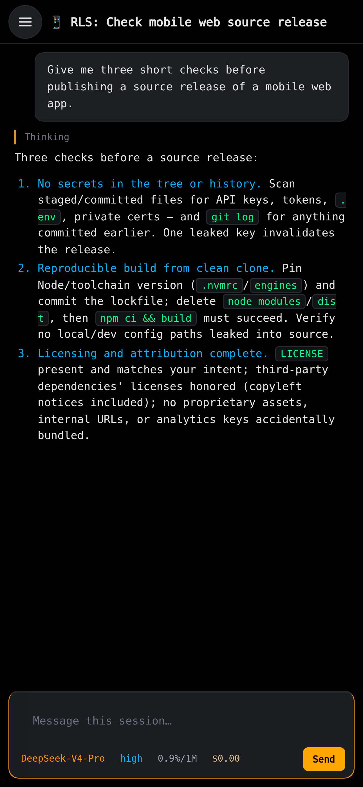
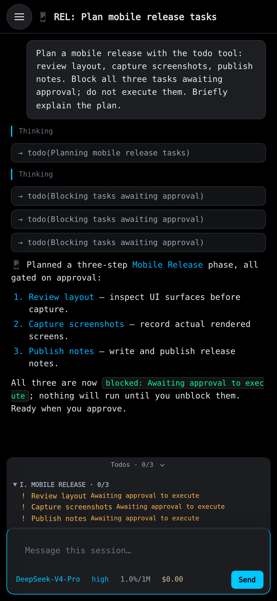
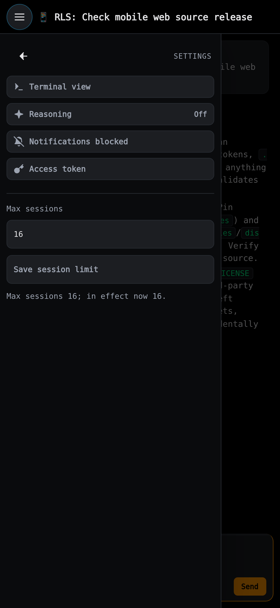

# OMP Mobile

**Your desktop sessions. On your phone.**

Send prompts, read replies and switch sessions from your phone. OMP Mobile uses the same live [OMP](https://omp.sh)
sessions as [OMP Desktop](https://github.com/cpu23/omp-desktop); add it to your home screen.

<p>
  
  
  
</p>

## Requirements

- Linux or macOS host with Git, [Bun 1.3.14+](https://bun.sh) and [OMP 18.x](https://omp.sh) on `PATH`; run `omp` once
  and complete provider setup. Mobile's structured UI integration is verified against OMP 18.12.1.
- Current phone browser. HTTPS is required for remote access and home-screen installation; [Tailscale](https://tailscale.com/download)
  is the simplest private connection.

## Quick setup

Run on the host in a directory for both sibling checkouts. Skip cloning a repository you already have.

```sh
git clone https://github.com/cpu23/omp-desktop.git && git clone https://github.com/cpu23/omp-mobile.git
```

Start Mobile and save the printed token; setup reuses an existing valid token:

```sh
cd omp-mobile && bun install --frozen-lockfile && bun run setup && bun run setup --show && bun run start
```

In a second terminal, start Desktop from the same parent directory:

```sh
cd omp-desktop && bun install --frozen-lockfile && bun run start
```

Keep both terminals open. Locally, open <http://127.0.0.1:4173> and enter the token. For phone access, join the same
Tailscale network on both devices, then run on the host:

```sh
tailscale serve --bg 4173
```

Open Tailscale's HTTPS URL, enter the token and use **Add to Home Screen** in your browser. Keep Desktop port 4180
local; share only the Mobile gateway over HTTPS.

## Releases

### Unreleased

- Render rule/system-violation notices, provider failures, retry/fallback/compaction state, goals, custom messages,
  execution output, summaries and file mentions.
- Surface pending `ask`, approvals and terminal-owned dialogs with live phone controls; render native plan reviews
  with refinement feedback and execution-tier choices when supplied by OMP.
- Display images, Mermaid, sanitized SVG, math and table-derived charts; attach images from the composer.
- Load older history and recover full output/images instead of silently truncating; notify when a session needs action.
- Load full message content and images automatically, and simplify transcript cards: hide role/time headers and routine
  served-by/model-routing/default-role metadata, thinking-level-change notices, and time-traveling rule trigger/injection
  notices and per-message token/cache/cost rows while retaining important failures and tool output.
- Keep the slash-command menu hidden when empty or a dialog is pending, removing the empty strip above the composer;
  shorten the composer's medium thinking-level label to `med` without changing the selected level.
- Use a wide pill-shaped thinking slider with session-accent fill and label, visible stop markers, a large white thumb and readable
  labels such as “Extra High effort”; it overlays the composer and dismisses on taps outside the rail. Pointer drags
  preserve composer focus and resist polling updates until release.
- Keep the empty composer's placeholder out of editable text layout so the caret starts at the left text inset.
- Tighten composer metadata gaps and padding; keep effort, context and cost readable, truncating only long model names when needed.
- Round the composer to 22px, with its context track inheriting the same corner radius.
- Keep the activity drawer narrow at 90% when collapsed and full composer width when expanded, with a continuous
  rounded top and no bottleneck.
- Render background `async-result` messages as collapsed tool-style result cards; expand to read the complete output and job details.
- Integrate passive runtime notices, compaction summaries, retries/fallbacks, goals and custom events into the chat
  stream as compact expandable rows, retaining rich output and error styling. Keep actionable dialogs prominent.
- Hide title changes, provider pins, bookmarks, mode changes and duplicate compaction-start notices; show unread
  session completion as a small sidebar dot rather than a numbered badge.

See [UI coverage and host limits](docs/guide.md#transcript-and-interaction-coverage) before upgrading live sessions.

**v0.1.1 — Source release; no native binaries or app-store packages.** [GitHub release](https://github.com/cpu23/omp-mobile/releases/tag/v0.1.1) · [Release notes](docs/release-v0.1.1.md).

## Upstream & ecosystem

[OMP](https://omp.sh) · [Source](https://github.com/can1357/oh-my-pi) · [Releases](https://github.com/can1357/oh-my-pi/releases) · [Skills](https://omp.sh/docs/skills) · [Plugins](https://omp.sh/docs/plugins) · [Community (Discord)](https://discord.com/invite/4NMW9cdXZa)

[OMP Desktop companion](https://github.com/cpu23/omp-desktop) · [PWA installation](https://web.dev/learn/pwa/installation) · [Tailscale Serve](https://tailscale.com/docs/features/tailscale-serve) · [Bun](https://bun.sh/docs)

## More

[Settings and help](docs/guide.md) · [Other connection methods](docs/guide.md#remote-access) · [MIT license](LICENSE)
